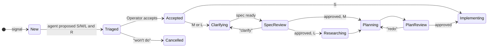
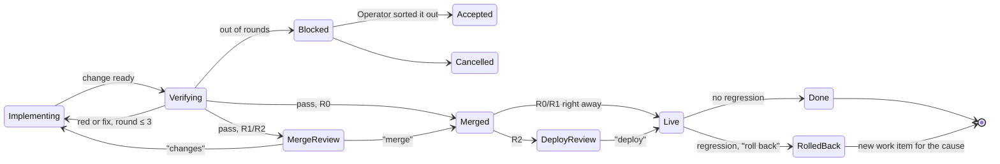

# Agentic development pipeline

How a work item travels from a signal to production, who does what, and where the human decides

Draft v1 · generated from the model in this repository · updated with it

---

# How to read the diagrams

  
<likec4-view view-id="legendAgent" color-scheme="light" class="lv"></likec4-view>
Works on its own: reads, writes, calls tools

  
<likec4-view view-id="legendScript" color-scheme="light" class="lv"></likec4-view>
A check or action: same input, same answer

  
<likec4-view view-id="legendGate" color-scheme="light" class="lv"></likec4-view>
Nothing moves on without the Operator's decision

  
<likec4-view view-id="legendOperator" color-scheme="light" class="lv"></likec4-view>
The person over the agents

  
<likec4-view view-id="legendStore" color-scheme="light" class="lv"></likec4-view>
Where work items, PRs and checks live

  
<likec4-view view-id="legendStage" color-scheme="light" class="lv"></likec4-view>
Runs left to right; click to open it

  
<likec4-view view-id="legendCross" color-scheme="light" class="lv"></likec4-view>
Orchestrator, sandbox, traces

  

    
<svg viewBox="0 0 120 12"><line x1="2" y1="6" x2="108" y2="6" stroke="#2563eb" stroke-width="2.5" stroke-dasharray="7 5"/><path d="M106 1 L118 6 L106 11 Z" fill="#2563eb"/></svg>hand-off of work

    
<svg viewBox="0 0 120 12"><line x1="2" y1="6" x2="108" y2="6" stroke="#be123c" stroke-width="2.5" stroke-dasharray="7 5"/><path d="M106 1 L118 6 L106 11 Z" fill="#be123c"/></svg>verdict (JSON)

    
<svg viewBox="0 0 120 12"><line x1="2" y1="6" x2="108" y2="6" stroke="#475569" stroke-width="2.5" stroke-dasharray="7 5"/><path d="M106 1 L118 6 L106 11 Z" fill="#475569"/></svg>reads or writes

  

Loops back ("fix", "new work item") are shown on the stage views · Every part has a status: <b>built</b> · <b>planned</b> · <b>idea</b>

---

# Whole pipeline

<likec4-view view-id="index" color-scheme="light" browser="true" class="view-wide"></likec4-view>⤢ Click the diagram to explore: zoom, pan, open any stage

Nine stages that Stripe, Anthropic, Spotify, Google, Cognition, AWS AI-DLC and others converge on. The Operator on top, stores below the stages that use them.

---

# What moves and where it lives

  Signal<i>→</i>Work item<i>→</i>Spec · plan<i>→</i>Change set<i>→</i>Checks<i>→</i>Review · merge<i>→</i>Deployment<i>→</i>Incident<i>↺</i>

  
<likec4-view view-id="storeTracker" color-scheme="light" class="sv"></likec4-view>
GitHub Issues · Jira

<b>The hub.</b> Number, size, risk, state. Everything links to the number.

  
<likec4-view view-id="storeDocs" color-scheme="light" class="sv"></likec4-view>
files in the repo or the work item body

What "done" means and how we get there.

  
<likec4-view view-id="storeChanges" color-scheme="light" class="sv"></likec4-view>
PR · MR

The code change, its reviews and verdicts.

  
<likec4-view view-id="storeCi" color-scheme="light" class="sv"></likec4-view>
CI

Test, lint and build output tied to the commit.

  
<likec4-view view-id="storeReleases" color-scheme="light" class="sv"></likec4-view>
Dokploy · TeamCity

Which version runs where and how the rollout ended.

  
<likec4-view view-id="storeProd" color-scheme="light" class="sv"></likec4-view>
Running services

Errors and incidents here start new work items.

Names
Artifact names follow the CDEvents standard (CD Foundation): ticket, change, build, release, incident. The tool under each block is today's choice; the pipeline talks to it through an adapter.

---

# Work item size and risk

**Size** decides what is written down and approved. The agent always reads the code.

| | What | The Operator approves |
|---|---|---|
| **S** | small | nothing, straight to code |
| **M** | a feature in one module | spec and plan |
| **L** | many modules | research, spec, plan |

**Risk** decides how to merge and deploy.

| | What | Merge | Production |
|---|---|---|---|
| **R0** | reversible, stays inside | itself | right away |
| **R1** | regular code behind checks | Operator, on evidence | right away |
| **R2** | irreversible or leaves the system | Operator reads the code | Operator |

The agent proposes size and risk with a reason; the Operator corrects them when accepting the work item.

---
layout: default
---

# 1. Intake

A signal becomes a work item. An agent proposes size and risk; the Operator accepts it.

<likec4-view view-id="intake" color-scheme="light" browser="true" class="view"></likec4-view>⤢ Click to explore

**Work item states:** New → Triaged → Accepted / Cancelled

**The Operator decides:** Accept

| Part | Who | Status | What it does |
|---|---|---|---|
| **Triage** | agent | idea | Merges duplicates, proposes size S/M/L and risk R0/R1/R2 with a reason. Never closes anything itself. |
| **Accept** | Operator decides | idea | The Operator sees size and risk, may correct them, and accepts the work item. |

Stage inputs and outputs

**In:**
- Monitoring → Triage: alert
- Operator → Accept: accepts

**Out:**
- Triage → Work items: work item
- Accept → Interviewer: M, L
- Accept → Implementer: S: straight to code

---
layout: default
---

# 2. Spec

M and L only. The agent clarifies and writes what "done" means.

<likec4-view view-id="spec" color-scheme="light" browser="true" class="view"></likec4-view>⤢ Click to explore

**Work item states:** Clarifying → SpecReview

**The Operator decides:** Approve spec

| Part | Who | Status | What it does |
|---|---|---|---|
| **Interviewer** | agent | idea | Asks about what is underspecified, writes the spec: why, acceptance criteria, what must not change. |
| **Approve spec** | Operator decides | idea | M and L: the Operator approves the spec. |

Stage inputs and outputs

**In:**
- Accept → Interviewer: M, L
- Operator → Approve spec: approves

**Out:**
- Interviewer → Specs and plans: spec
- Approve spec → Codebase researcher: L
- Approve spec → Planner: M
- Interviewer → Operator: questions

---
layout: default
---

# 3. Plan

M and L only. How we do it, in slices, and how we prove it is done.

<likec4-view view-id="plan" color-scheme="light" browser="true" class="view"></likec4-view>⤢ Click to explore

**Work item states:** Researching (L) → Planning → PlanReview

**The Operator decides:** Approve plan

| Part | Who | Status | What it does |
|---|---|---|---|
| **Codebase researcher** | agent | idea | L only: a separate read-only pass; the result is a short document on affected modules and invariants. |
| **Planner** | agent | idea | A plan in slices: files, order, risks, a check command for each slice. |
| **Approve plan** | Operator decides | idea | M and L: the main Operator gate. A wrong idea is cheaper to catch before code. |

Stage inputs and outputs

**In:**
- Approve spec → Codebase researcher: L
- Approve spec → Planner: M
- Operator → Approve plan: approves

**Out:**
- Planner → Specs and plans: plan
- Approve plan → Implementer: plan

---
layout: default
---

# 4. Implement

The agent writes the change in the sandbox. S comes here straight from intake.

<likec4-view view-id="implement" color-scheme="light" browser="true" class="view"></likec4-view>⤢ Click to explore

**Work item states:** Implementing

**The Operator decides:** nothing — this stage runs without a human

| Part | Who | Status | What it does |
|---|---|---|---|
| **Implementer** | agent | built | Reads the code it needs and writes one slice in a fresh context. |

Stage inputs and outputs

**In:**
- Accept → Implementer: S: straight to code
- Approve plan → Implementer: plan
- Checks → Implementer: red: fix, at most 2 rounds
- Judge → Implementer: fix
- Orchestrator → Implementer: runs in sandbox

**Out:**
- Implementer → Change sets: PR
- Implementer → Checks: run

---
layout: default
---

# 5. Self-verify

The agent never says "done" until checks are green. Rounds are capped.

<likec4-view view-id="verify" color-scheme="light" browser="true" class="view"></likec4-view>⤢ Click to explore

**Work item states:** Verifying (round ≤ 3, else Blocked)

**The Operator decides:** nothing — this stage runs without a human

| Part | Who | Status | What it does |
|---|---|---|---|
| **Checks** | script | planned | Tests, lint, types, build. They run by themselves, not on the agent word. |
| **Holdout tests** | script | idea | Scenarios the agent cannot see or edit. |
| **Evidence** | agent | idea | Screenshots, video, command output: what the Operator looks at instead of code. |

Stage inputs and outputs

**In:**
- Implementer → Checks: run

**Out:**
- Checks → Check results: results
- Evidence → Reviewers: PR + evidence
- Checks → Implementer: red: fix, at most 2 rounds

---
layout: default
---

# 6. AI review

Reviewer agents with a fresh context check against the spec and standards. An agent approval is not a human approval.

<likec4-view view-id="aiReview" color-scheme="light" browser="true" class="view"></likec4-view>⤢ Click to explore

**Work item states:** Verifying → MergeReview (R1/R2) or Merged (R0)

**The Operator decides:** nothing — this stage runs without a human

| Part | Who | Status | What it does |
|---|---|---|---|
| **Reviewers** | agent | built | Correctness, security, match with the spec. Findings ranked by severity, noise filtered out. |
| **Judge** | agent | built | Turns findings into a JSON verdict: pass / fix / block. |

Stage inputs and outputs

**In:**
- Evidence → Reviewers: PR + evidence

**Out:**
- Judge → Change sets: verdict
- Judge → Merge script: pass, R0
- Judge → Merge?: pass, R1/R2
- Judge → Implementer: fix

---
layout: default
---

# 7. Merge

By risk: R0 merges itself, R1 the Operator merges on evidence, R2 the Operator reads the code.

<likec4-view view-id="merge" color-scheme="light" browser="true" class="view"></likec4-view>⤢ Click to explore

**Work item states:** MergeReview → Merged

**The Operator decides:** Merge?

| Part | Who | Status | What it does |
|---|---|---|---|
| **Merge?** | Operator decides | idea | R1: report with evidence. R2: plus the code. |
| **Merge script** | script | planned | Merges only if the PR head is unchanged, the review was on that head and CI is green. The agent never merges. |

Stage inputs and outputs

**In:**
- Judge → Merge script: pass, R0
- Judge → Merge?: pass, R1/R2
- Operator → Merge?: reviews evidence

**Out:**
- Merge script → Change sets: merge
- Merge script → Deploy: R0, R1
- Merge script → Deploy R2?: R2

---
layout: default
---

# 8. Deploy & watch

R0 and R1 go to production right after merge, R2 on the Operator yes. A watcher compares metrics before and after.

<likec4-view view-id="deploy" color-scheme="light" browser="true" class="view"></likec4-view>⤢ Click to explore

**Work item states:** Merged → DeployReview (R2) → Live → Done / RolledBack

**The Operator decides:** Deploy R2?

| Part | Who | Status | What it does |
|---|---|---|---|
| **Deploy R2?** | Operator decides | idea | R2 only: migrations, infrastructure, money, secrets. |
| **Deploy** | script | built | Deploys and can roll back in one step. |
| **Watcher** | agent | idea | Read-only: compares metrics before and after; on a regression proposes a rollback to the Operator. |

Stage inputs and outputs

**In:**
- Merge script → Deploy: R0, R1
- Merge script → Deploy R2?: R2
- Operator → Deploy R2?: deploys
- Production → Watcher: metrics

**Out:**
- Deploy → Deployments: version
- Deploy → Production: rollout
- Watcher → Retro: rollout outcome
- Watcher → Operator: regression: roll back?

---
layout: default
---

# 9. Learn

Mistakes and corrections become new work items, checks and rules.

<likec4-view view-id="learn" color-scheme="light" browser="true" class="view"></likec4-view>⤢ Click to explore

**Work item states:** new work items in New

**The Operator decides:** Adopt rule?

| Part | Who | Status | What it does |
|---|---|---|---|
| **Retro** | agent | idea | Weekly: what repeated twice becomes a proposed rule, check or work item. |
| **Adopt rule?** | Operator decides | idea | The Operator picks which proposals to adopt. |

Stage inputs and outputs

**In:**
- Watcher → Retro: rollout outcome
- Operator → Adopt rule?: chooses
- Session traces → Retro: session traces

**Out:**
- Retro → Work items: new work items
- Adopt rule? → Orchestrator: new rule or check

---

# Life of one work item

<likec4-view view-id="task" color-scheme="light" browser="true" class="view-wide"></likec4-view>⤢ Click the diagram to explore: zoom, pan, open any stage

Branches by size (S / M / L) and risk (R0 / R1 / R2). The "checks → review → fix" loop runs at most 3 times; then the work item is blocked and waits for the Operator.

---

# Work item states

**Part 1. Preparation: from signal to approved plan**

The state lives in the tracker: a <code>state:…</code> label in GitHub, a status in Jira. At most 3 work items wait for the Operator at once. <b>Draft, awaiting approval.</b>

---

# Work item states

**Part 2. Execution: from code to production**

The state lives in the tracker: a <code>state:…</code> label in GitHub, a status in Jira. At most 3 work items wait for the Operator at once. <b>Draft, awaiting approval.</b>

---

# Cross-cutting parts

<likec4-view view-id="platform" color-scheme="light" browser="true" class="view-wide"></likec4-view>⤢ Click the diagram to explore: zoom, pan, open any stage

---
layout: default
---

# Decisions

| # | Question | Decision |
|---|---|---|
| 1 | Where the main human gates sit | On the spec and plan, before code. Merge by risk class |
| 2 | How heavy the spec is | By work item size. The agent always reads the code and plans; size decides what is written down and what the Operator approves. S: straight to code; M: spec and plan; L: plus a codebase research document |
| 3 | What to look at before merge | Evidence: check output, screenshots, video. Code only for risky changes |
| 4 | Where the pipeline hub is | The tracker: spec, agent sessions and PRs link to the work item number |
| 5 | Tracker | Two from day one: GitHub Issues and Jira, behind a common "work items" layer; each tool is an adapter |
| 6 | How to merge by risk | R0 merges itself on green checks and AI review; R1 the Operator merges on evidence; R2 the Operator reads the code |
| 7 | Who sets size and risk | The agent proposes with a reason; the Operator corrects when accepting the work item |
| 8 | When a change goes to production | R0 and R1 right after merge; a watcher compares metrics and proposes a rollback. R2 the Operator deploys |
| 9 | How many work items in parallel | At most N (start with 3) wait for the Operator at once; beyond that new ones do not start |
| 10 | Which repositories first | Personal and work ones at once |
| 11 | How the pipeline talks to the Operator | By universal presentation rules: decision type sets the depth, a real before/after case is mandatory, "not verified" on top, form chosen by the task. Recommendation first for small decisions, after the facts for big ones |
| 12 | Where the Operator works with the pipeline | Claude Desktop for now |
| 13 | Language | Everything in the project in English: model, docs, deck, research |

---

# Open questions

1. **Engine** to build the pipeline on: our own on top of an existing one, or an existing one only if it fits completely.
2. **Work item states** — draft, awaiting approval.
3. **Measurement on real work items:** Operator time, share done without manual help, rollbacks, $ per change.
4. **Deep dives** on the key research topics: verification the agent cannot reach, catching false "done", agent rights in the sandbox.

Model, research and this deck live in one repository. The deck is built from the model with <code>npm run deck:gen</code>.

