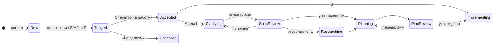
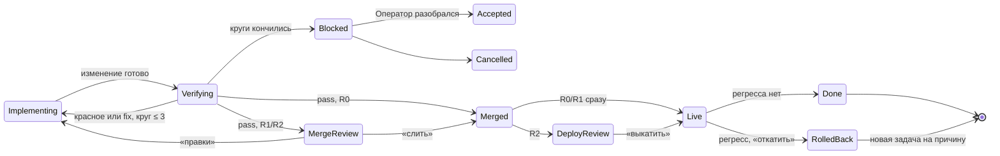

# Конвейер разработки на агентах

Как задача проходит путь от сигнала до прода, кто что делает и где решает человек

Черновик v1 · собрано из модели в репозитории · обновляется вместе с ней

---

# Зачем

Писать код агенты уже умеют. Узкое место — проверка и внимание человека.

| Что видно у лидеров | Цифра | Источник |
|---|---|---|
| Коммитов с ИИ сильно больше, релизов — чуть больше | +240% коммитов, +30% релизов | NBER, 500 тыс. разработчиков |
| Разработчики с ИИ были медленнее, но думали, что быстрее | −19% | METR, контролируемый эксперимент |
| С ИИ поставок больше, а стабильность хуже | — | DORA 2025 |

**Цель конвейера:** доверять результату при минимуме участия человека. Мерим время Оператора на изменение, долю задач без ручной помощи, откаты и $ на изменение.

---

# Как читать схемы

| Цвет | Кто |
|---|---|
| фиолетовый | **агент** — модель, работает сама |
| зелёный | **скрипт** — проверка или действие без модели |
| красный | **ворота** — решает Оператор |
| оранжевый | **Оператор** — человек над агентами |
| серый цилиндр | **хранилище** — где лежат задачи, PR, проверки |

- Стадии идут **слева направо**.
- Клик по стадии на интерактивной схеме открывает её устройство.
- Петли назад («чинить», «новая задача») показаны на схемах стадий.
- Инструмент (GitHub, Jira, Dokploy) — только подпись. Схема от инструментов не зависит.
- Статус части: **есть** · **решено строить** · **идея**.

---

# Весь конвейер

Девять стадий, к которым сходятся Stripe, Anthropic, Spotify, Google, Cognition, AWS AI-DLC и другие. Снизу — хранилища.

---

# Что движется и где лежит

Сигнал → **задача** → спека → план → **изменение** → результаты проверок → ревью → слитое изменение → **выкатка** → инцидент → снова сигнал

| Хранилище | Что в нём | Сейчас |
|---|---|---|
| **Задачи** | центр: номер, размер, риск, состояние; всё ссылается на номер | GitHub Issues · Jira |
| **Спеки и планы** | что значит «готово», как делаем | файлы в репозитории или тело задачи |
| **Изменения** | PR, ревью, вердикты | PR · MR |
| **Результаты проверок** | вывод тестов, привязанный к коммиту | CI |
| **Выкатки** | какая версия где и чем кончилось | Dokploy |

Названия артефактов — из стандарта CDEvents (CD Foundation): ticket, change, build, release, incident.

---

# Размер задачи и риск

**Размер** — что записывается и утверждается. Код агент читает всегда.

| | Что | Оператор утверждает |
|---|---|---|
| **S** | мелочь | ничего, сразу код |
| **M** | фича в модуле | спеку и план |
| **L** | много модулей | исследование, спеку, план |

**Риск** — как сливать и выкатывать.

| | Что | Слияние | Прод |
|---|---|---|---|
| **R0** | обратимо, наружу не уходит | само | сразу |
| **R1** | обычный код за проверками | Оператор по доказательствам | сразу |
| **R2** | необратимо или наружу | Оператор читает код | Оператор |

Размер и риск предлагает агент с причиной, Оператор правит, когда берёт задачу в работу.

---
layout: default
---

# 1. Приём задачи

Сигнал становится задачей. Агент предлагает размер и риск, Оператор берёт в работу.

**Состояния задачи:** New → Triaged → Accepted / Cancelled

**Решает Оператор:** Взять в работу

| Часть | Кто | Статус | Что делает |
|---|---|---|---|
| **Сортировщик** | агент | идея | Склеивает дубли, предлагает размер S/M/L и риск R0/R1/R2 с причиной. Сам ничего не закрывает. |
| **Взять в работу** | решает Оператор | идея | Оператор видит размер и риск, может поправить и жмёт «в работу». |

Вход и выход стадии

**Приходит:**
- Мониторинг → Сортировщик: алерт
- Оператор → Взять в работу: в работу

**Уходит:**
- Сортировщик → Задачи: задача
- Взять в работу → Интервьюер: M, L
- Взять в работу → Исполнитель: S: сразу код

---
layout: default
---

# 2. Спецификация

Только для M и L. Агент уточняет и пишет, что значит «готово».

**Состояния задачи:** Clarifying → SpecReview

**Решает Оператор:** Утвердить спеку

| Часть | Кто | Статус | Что делает |
|---|---|---|---|
| **Интервьюер** | агент | идея | Задаёт вопросы по недоопределённому, пишет спеку: зачем, критерии приёмки, что нельзя менять. |
| **Утвердить спеку** | решает Оператор | идея | M и L: Оператор утверждает спеку. |

Вход и выход стадии

**Приходит:**
- Взять в работу → Интервьюер: M, L
- Оператор → Утвердить спеку: утверждает

**Уходит:**
- Интервьюер → Спеки и планы: спека
- Утвердить спеку → Исследователь кода: L
- Утвердить спеку → Планировщик: M
- Интервьюер → Оператор: вопросы

---
layout: default
---

# 3. План

Только для M и L. Как делаем, срезами, и чем докажем готовность.

**Состояния задачи:** Researching (L) → Planning → PlanReview

**Решает Оператор:** Утвердить план

| Часть | Кто | Статус | Что делает |
|---|---|---|---|
| **Исследователь кода** | агент | идея | Только L: отдельный проход на чтение, итог — короткий документ о затронутых модулях и инвариантах. |
| **Планировщик** | агент | идея | План срезами: файлы, порядок, риски, команда проверки у каждого среза. |
| **Утвердить план** | решает Оператор | идея | M и L: главные ворота Оператора — ошибку замысла дешевле поймать до кода. |

Вход и выход стадии

**Приходит:**
- Утвердить спеку → Исследователь кода: L
- Утвердить спеку → Планировщик: M
- Оператор → Утвердить план: утверждает

**Уходит:**
- Планировщик → Спеки и планы: план
- Утвердить план → Исполнитель: план

---
layout: default
---

# 4. Реализация

Агент пишет изменение в песочнице. S приходит сюда сразу из приёма.

**Состояния задачи:** Implementing

**Решает Оператор:** ничего — стадия идёт без человека

| Часть | Кто | Статус | Что делает |
|---|---|---|---|
| **Исполнитель** | агент | есть | Читает нужный код, пишет изменение одного среза в свежем контексте. |

Вход и выход стадии

**Приходит:**
- Взять в работу → Исполнитель: S: сразу код
- Утвердить план → Исполнитель: план
- Проверки → Исполнитель: красное: чинить, не больше 2 кругов
- Судья → Исполнитель: fix
- Оркестратор → Исполнитель: запускает в песочнице

**Уходит:**
- Исполнитель → Изменения: PR
- Исполнитель → Проверки: прогон

---
layout: default
---

# 5. Самопроверка

Агент не говорит «готово», пока проверки не зелёные. Круги ограничены.

**Состояния задачи:** Verifying (круг ≤ 3, иначе Blocked)

**Решает Оператор:** ничего — стадия идёт без человека

| Часть | Кто | Статус | Что делает |
|---|---|---|---|
| **Проверки** | скрипт | решено строить | Тесты, линт, типы, сборка. Запускаются сами, а не по слову агента. |
| **Скрытые тесты** | скрипт | идея | Сценарии, которых агент не видит и не может править. |
| **Доказательства** | агент | идея | Снимки экрана, видео, вывод команд — то, что Оператор смотрит вместо кода. |

Вход и выход стадии

**Приходит:**
- Исполнитель → Проверки: прогон

**Уходит:**
- Проверки → Результаты проверок: результаты
- Доказательства → Ревьюеры: PR + доказательства
- Проверки → Исполнитель: красное: чинить, не больше 2 кругов

---
layout: default
---

# 6. ИИ-ревью

Агенты-ревьюеры со свежим контекстом сверяют со спекой и стандартами. Одобрение агента не равно одобрению человека.

**Состояния задачи:** Verifying → MergeReview (R1/R2) или Merged (R0)

**Решает Оператор:** ничего — стадия идёт без человека

| Часть | Кто | Статус | Что делает |
|---|---|---|---|
| **Ревьюеры** | агент | есть | Корректность, безопасность, соответствие спеке. Замечания по важности, шум отфильтрован. |
| **Судья** | агент | есть | Сводит замечания в вердикт JSON: pass / fix / block. |

Вход и выход стадии

**Приходит:**
- Доказательства → Ревьюеры: PR + доказательства

**Уходит:**
- Судья → Изменения: вердикт
- Судья → Скрипт слияния: pass, R0
- Судья → Слить?: pass, R1/R2
- Судья → Исполнитель: fix

---
layout: default
---

# 7. Слияние

По риску: R0 сливается само, R1 — Оператор по доказательствам, R2 — Оператор читает код.

**Состояния задачи:** MergeReview → Merged

**Решает Оператор:** Слить?

| Часть | Кто | Статус | Что делает |
|---|---|---|---|
| **Слить?** | решает Оператор | идея | R1: карточка с отчётом и доказательствами. R2: ещё и код. |
| **Скрипт слияния** | скрипт | решено строить | Сливает только если голова PR та же, ревью было на ней и CI зелёный. Агент сам не сливает. |

Вход и выход стадии

**Приходит:**
- Судья → Скрипт слияния: pass, R0
- Судья → Слить?: pass, R1/R2
- Оператор → Слить?: смотрит доказательства

**Уходит:**
- Скрипт слияния → Изменения: слияние
- Скрипт слияния → Выкатка: R0, R1
- Скрипт слияния → Выкатить R2?: R2

---
layout: default
---

# 8. Выкатка и наблюдение

R0 и R1 уходят в прод сразу после слияния, R2 — по «да» Оператора. Дозор сравнивает метрики до и после.

**Состояния задачи:** Merged → DeployReview (R2) → Live → Done / RolledBack

**Решает Оператор:** Выкатить R2?

| Часть | Кто | Статус | Что делает |
|---|---|---|---|
| **Выкатить R2?** | решает Оператор | идея | Только R2: миграции, инфраструктура, деньги, секреты. |
| **Выкатка** | скрипт | есть | Выкатывает и умеет откатить одним шагом. |
| **Дозор** | агент | идея | Только чтение: сравнивает метрики до и после, при регрессе предлагает откат карточкой. |

Вход и выход стадии

**Приходит:**
- Скрипт слияния → Выкатка: R0, R1
- Скрипт слияния → Выкатить R2?: R2
- Оператор → Выкатить R2?: выкатывает
- Прод → Дозор: метрики

**Уходит:**
- Выкатка → Выкатки: версия
- Выкатка → Прод: выкатка
- Дозор → Разбор: итог выкатки
- Дозор → Оператор: регресс: откатить?

---
layout: default
---

# 9. Разбор и обучение

Ошибки и поправки становятся новыми задачами, проверками и правилами.

**Состояния задачи:** новые задачи в New

**Решает Оператор:** Принять правило?

| Часть | Кто | Статус | Что делает |
|---|---|---|---|
| **Разбор** | агент | идея | Раз в неделю: что повторилось дважды — предложение правила, проверки или новой задачи. |
| **Принять правило?** | решает Оператор | идея | Оператор выбирает, что из предложенного принять. |

Вход и выход стадии

**Приходит:**
- Дозор → Разбор: итог выкатки
- Оператор → Принять правило?: выбирает
- Записи сессий → Разбор: записи сессий

**Уходит:**
- Разбор → Задачи: новые задачи
- Принять правило? → Оркестратор: новое правило или проверка

---

# Путь одной задачи

Ветвление по размеру (S / M / L) и по риску (R0 / R1 / R2). Цикл «проверки → ревью → доработка» — не больше 3 кругов, потом задача застревает и ждёт Оператора.

---

# Состояния задачи

**Часть 1. Подготовка: от сигнала до утверждённого плана**

Состояние живёт в трекере: в GitHub — метка <code>state:…</code>, в Jira — статус. Не больше 3 задач одновременно в состояниях «ждёт Оператора». <b>Черновик — ждёт утверждения.</b>

---

# Состояния задачи

**Часть 2. Исполнение: от кода до прода**

Состояние живёт в трекере: в GitHub — метка <code>state:…</code>, в Jira — статус. Не больше 3 задач одновременно в состояниях «ждёт Оператора». <b>Черновик — ждёт утверждения.</b>

---

# Сквозные части

---
layout: default
---

# Принятые решения

| # | Вопрос | Решение |
|---|---|---|
| 1 | Где главные ворота человека | На спеке и плане, до кода. Слияние — по классу риска |
| 2 | Насколько подробна спека | По размеру задачи. Агент всегда читает код и строит план; размер решает, что записывается и что утверждает Оператор. S — сразу код; M — спека и план; L — ещё документ исследования кода |
| 3 | Что смотреть перед слиянием | Доказательства: вывод проверок, снимки, видео. Код — только у рискованного |
| 4 | Где центр конвейера | Трекер задач: спека, сессии агентов, PR ссылаются на номер задачи |
| 5 | Трекер | Два с первого дня: GitHub Issues и Jira, через общий слой «задачи»; инструмент — адаптер |
| 6 | Как сливать по риску | R0 — само при зелёных проверках и ИИ-ревью; R1 — Оператор по доказательствам; R2 — Оператор читает код |
| 7 | Кто ставит размер и риск | Агент предлагает с причиной, Оператор правит, когда берёт задачу |
| 8 | Когда изменение уходит в прод | R0 и R1 — сразу после слияния, дозор сравнивает метрики и предлагает откат. R2 выкатывает Оператор |
| 9 | Сколько задач параллельно | Не больше N задач (начинаем с 3) одновременно ждут Оператора, дальше новые не стартуют |
| 10 | С каких репозиториев начинаем | Сразу личные и рабочие |
| 11 | Как конвейер говорит с Оператором | По универсальным правилам подачи: тип решения задаёт объём, пример «было → стало» обязателен, «не проверено» наверху, вид по задаче. Рекомендация в мелком — первой, в большом — после фактов |
| 12 | Где Оператор работает с конвейером | Пока в Claude Desktop |

---

# Что открыто

1. **Движок**, на котором собирать конвейер: свой поверх готового или готовый чужой, только если подходит полностью.
2. **Состояния задачи** — черновик, ждёт утверждения.
3. **Замер на реальных задачах:** время Оператора, доля задач без ручной помощи, откаты, $ на изменение.
4. **Глубокий разбор** главных тем исследования: проверка, до которой агент не дотянется, ловля ложного «готово», права агентов в песочнице.

Модель, исследования и эта презентация — в одном репозитории. Презентация собирается из модели командой <code>npm run deck:build</code>.

