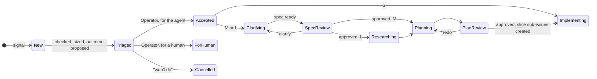
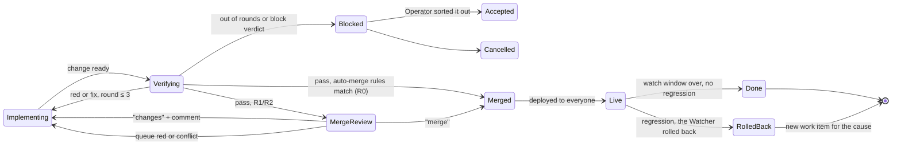

# Agentic development pipeline

How a work item travels from a signal to production, who does what, and where the human decides

Draft v1 · generated from the model in this repository · updated with it

---

# How to read the diagrams

  
<likec4-view view-id="legendAgent" color-scheme="light" class="lv"></likec4-view>
Works on its own: reads, writes, calls tools

  
<likec4-view view-id="legendScript" color-scheme="light" class="lv"></likec4-view>
A check or action: same input, same answer

  
<likec4-view view-id="legendGate" color-scheme="light" class="lv"></likec4-view>
Nothing moves on without the Operator's decision

  
<likec4-view view-id="legendOperator" color-scheme="light" class="lv"></likec4-view>
The person over the agents

  
<likec4-view view-id="legendStore" color-scheme="light" class="lv"></likec4-view>
Where work items, PRs and checks live

  
<likec4-view view-id="legendStage" color-scheme="light" class="lv"></likec4-view>
Runs left to right; click to open it

  
<likec4-view view-id="legendCross" color-scheme="light" class="lv"></likec4-view>
Orchestrator, sandbox, traces

  

    
<svg viewBox="0 0 120 12"><line x1="2" y1="6" x2="108" y2="6" stroke="#2563eb" stroke-width="2.5" stroke-dasharray="7 5"/><path d="M106 1 L118 6 L106 11 Z" fill="#2563eb"/></svg>hand-off of work

    
<svg viewBox="0 0 120 12"><line x1="2" y1="6" x2="108" y2="6" stroke="#be123c" stroke-width="2.5" stroke-dasharray="7 5"/><path d="M106 1 L118 6 L106 11 Z" fill="#be123c"/></svg>verdict (JSON)

    
<svg viewBox="0 0 120 12"><line x1="2" y1="6" x2="108" y2="6" stroke="#475569" stroke-width="2.5" stroke-dasharray="7 5"/><path d="M106 1 L118 6 L106 11 Z" fill="#475569"/></svg>writes into a store

    
<svg viewBox="0 0 120 12"><line x1="2" y1="6" x2="108" y2="6" stroke="#475569" stroke-width="2.5" stroke-dasharray="1.5 5" stroke-linecap="round"/><path d="M106 1 L118 6 L106 11 Z" fill="#475569"/></svg>reads from a store

  

Arrows point where the data goes · Loops back ("fix", "new work item") are shown on the stage views · Every part has a status: <b>built</b> · <b>planned</b> · <b>idea</b>

---

# Whole pipeline

<likec4-view view-id="index" color-scheme="light" browser="true" class="view-wide"></likec4-view>⤢ Click the diagram to explore: zoom, pan, open any stage

Nine stages that Stripe, Anthropic, Spotify, Google, Cognition, AWS AI-DLC and others converge on. The Operator on top, stores below the stages that use them.

---

# What moves and where it lives

A work item fills these stores in order, left to right, top to bottom. An incident in production opens a new work item.

  
<likec4-view view-id="storeTracker" color-scheme="light" class="sv"></likec4-view>
GitHub Issues · Jira

<b>The hub.</b> Number, size, risk, state. Everything links to the number.

  
<likec4-view view-id="storeDocs" color-scheme="light" class="sv"></likec4-view>
files in the repo or the work item body

Spec and plan of each work item; decision records (ADR).

  
<likec4-view view-id="storeChanges" color-scheme="light" class="sv"></likec4-view>
PR · MR

The code change, evidence, review, verdict and its explanation.

  
<likec4-view view-id="storeCi" color-scheme="light" class="sv"></likec4-view>
CI

Test, lint and build output tied to the commit.

  
<likec4-view view-id="storeReleases" color-scheme="light" class="sv"></likec4-view>
Dokploy · TeamCity

Which version runs where and how the rollout ended.

  
<likec4-view view-id="storeProd" color-scheme="light" class="sv"></likec4-view>
Running services

Errors and incidents here start new work items.

Names
Artifact names follow the CDEvents standard (CD Foundation): ticket, change, build, release, incident. The tool under each block is today's choice; the pipeline talks to it through an adapter.

---

# Work item size and risk

  <h3><b>Size</b> decides what is written and approved</h3>
  
S

Small change <em class="ag">agent goes straight to code</em>

e.g. fix the text of an error message

  
M

A feature in one module <em class="op">Operator approves spec and plan</em>

e.g. add CSV export to a report

  
L

Many modules <em class="op">Operator approves research, spec, plan</em>

e.g. move sign-in to a new provider

  <h3><b>Risk</b> decides who merges and deploys</h3>
  
R0

Matches the auto-merge rules <em class="ag">merges and deploys without the Operator</em>

e.g. docs, tests, patch updates; never auth or payments

  
R1

Regular code behind checks <em class="op">Operator merges on evidence</em>

e.g. a regular feature; deploys right away

  
R2

Irreversible or leaves the system <em class="op">Operator reads the code, merge deploys</em>

e.g. a database migration, payments, sending email

The agent proposes size and risk with a reason; the Operator corrects them on accepting the work item.

---
layout: default
---

# 1. Intake

A signal becomes a work item. An agent proposes size and risk; the Operator accepts it.

<likec4-view view-id="intakeDeck" color-scheme="light" browser="true" class="view-stage"></likec4-view>⤢ Click to explore

  

Agentidea

Triage
<dl class="eg3"><dt>In</dt><dd>A request, a bug or an alert</dd><dt>Does</dt><dd>Investigates on its own: duplicates, already built, rejected before, reproduces a bug; writes down assumptions</dd><dt>Out</dt><dd>Size, risk, assumptions and an outcome: for agent, for a human, won't do</dd></dl>

  

Gateidea

Accept
<dl class="eg3"><dt>In</dt><dd>Size, risk, assumptions and the proposed outcome</dd><dt>Does</dt><dd>The Operator accepts, corrects or rejects</dd><dt>Out</dt><dd>Agent: S → Implement, M, L → Spec; or for a human; or won't do</dd></dl>

<b>Work item states:</b> New → Triaged → Accepted / ForHuman / Cancelled &nbsp;·&nbsp; <b>The Operator decides:</b> Accept

---
layout: default
---

# 2. Spec

M and L only. The agent clarifies and writes what "done" means.

<likec4-view view-id="specDeck" color-scheme="light" browser="true" class="view-stage"></likec4-view>⤢ Click to explore

  

Agentidea

Interviewer
<dl class="eg3"><dt>In</dt><dd>An accepted M or L work item</dd><dt>Does</dt><dd>Asks the Operator about what is unclear</dd><dt>Out</dt><dd>Spec: why, criteria with key examples, what must not change</dd></dl>

  

Gateidea

Approve spec
<dl class="eg3"><dt>In</dt><dd>The spec</dd><dt>Does</dt><dd>The Operator approves or edits it</dd><dt>Out</dt><dd>M → Plan; L → codebase research</dd></dl>

<b>Work item states:</b> Clarifying → SpecReview &nbsp;·&nbsp; <b>The Operator decides:</b> Approve spec

---
layout: default
---

# 3. Plan

M and L only. How we do it, in slices, and how we prove it is done.

<likec4-view view-id="planDeck" color-scheme="light" browser="true" class="view-stage"></likec4-view>⤢ Click to explore

  

Agentidea

Codebase researcher
<dl class="eg3"><dt>In</dt><dd>An approved L spec</dd><dt>Does</dt><dd>Reads the code only, changes nothing</dd><dt>Out</dt><dd>Research: affected modules, what must stay true</dd></dl>

  

Agentidea

Planner
<dl class="eg3"><dt>In</dt><dd>The spec, past decisions, research (L)</dd><dt>Does</dt><dd>Splits the work into slices</dd><dt>Out</dt><dd>Plan; one sub-issue per slice with "blocked by" links</dd></dl>

  

Gateidea

Approve plan
<dl class="eg3"><dt>In</dt><dd>The plan</dd><dt>Does</dt><dd>The Operator approves or edits it</dd><dt>Out</dt><dd>The work item goes to Implement</dd></dl>

<b>Work item states:</b> Researching (L) → Planning → PlanReview &nbsp;·&nbsp; <b>The Operator decides:</b> Approve plan

---
layout: default
---

# 4. Implement

The agent writes the change in the sandbox. S comes here straight from intake.

<likec4-view view-id="implementDeck" color-scheme="light" browser="true" class="view-stage"></likec4-view>⤢ Click to explore

  

Agentbuilt

Implementer
<dl class="eg3"><dt>In</dt><dd>A slice of the plan (for S, the work item) and the code</dd><dt>Does</dt><dd>Unit tests first, then code; fast checks in the sandbox</dd><dt>Out</dt><dd>A pushed branch, a PR</dd></dl>

<b>Work item states:</b> Implementing &nbsp;·&nbsp; <b>The Operator decides:</b> nothing, this stage runs without a human

---
layout: default
---

# 5. Checks & review

Cheap and deterministic first: CI outside the sandbox, then one AI reviewer reads the code. Their findings change code, so they run before the expensive acceptance pass.

<likec4-view view-id="verifyDeck" color-scheme="light" browser="true" class="view-stage"></likec4-view>⤢ Click to explore

  

Scriptplanned

CI checks
<dl class="eg3"><dt>In</dt><dd>The pushed branch</dd><dt>Does</dt><dd>Runs the full test suite, lint, types, build</dd><dt>Out</dt><dd>Green: on to the AI reviewer. Red: fix</dd></dl>

  

Agentbuilt

AI reviewer
<dl class="eg3"><dt>In</dt><dd>The PR after green CI, the spec, the code around it</dd><dt>Does</dt><dd>Finds and re-checks issues, skips nits, explains the change</dd><dt>Out</dt><dd>Pass: on to acceptance. Fix or block; for R1/R2 an explanation in the PR</dd></dl>

<b>Work item states:</b> Verifying (fix rounds ≤ 3 per work item, else Blocked) &nbsp;·&nbsp; <b>The Operator decides:</b> nothing, this stage runs without a human

---
layout: default
---

# 6. Acceptance

Last and most expensive: a separate Validator checks the acceptance criteria on the running app, as a user, and records evidence. It runs on code that will not change again.

<likec4-view view-id="aiReviewDeck" color-scheme="light" browser="true" class="view-stage"></likec4-view>⤢ Click to explore

  

Agentidea

Validator
<dl class="eg3"><dt>In</dt><dd>The reviewed PR, the acceptance criteria</dd><dt>Does</dt><dd>Checks each criterion and its examples as a user, records evidence</dd><dt>Out</dt><dd>Pass with evidence on the PR, or fail with the criterion that broke</dd></dl>

<b>Work item states:</b> Verifying → MergeReview (R1/R2) or Merged (R0) &nbsp;·&nbsp; <b>The Operator decides:</b> nothing, this stage runs without a human

---
layout: default
---

# 7. Merge

A script checks the auto-merge rules: a match merges without the Operator (R0), anything else goes to the Operator's gate. Everything lands through a merge queue on the latest main.

<likec4-view view-id="mergeDeck" color-scheme="light" browser="true" class="view-stage"></likec4-view>⤢ Click to explore

  

Scriptidea

Auto-merge rules
<dl class="eg3"><dt>In</dt><dd>The PR that passed acceptance, the rules file</dd><dt>Does</dt><dd>Checks paths, size, dependencies, never-zones, time</dd><dt>Out</dt><dd>Match: queue (R0). No match: the Operator's gate</dd></dl>

  

Gateidea

Merge?
<dl class="eg3"><dt>In</dt><dd>The PR: scope, explanation, evidence; for R2 the code</dd><dt>Does</dt><dd>The Operator: merge or changes with a comment</dd><dt>Out</dt><dd>Merge: to the queue. Changes: back to the Implementer</dd></dl>

  

Scriptplanned

Merge queue
<dl class="eg3"><dt>In</dt><dd>An approved PR</dd><dt>Does</dt><dd>Rebuilds on the latest main, runs the full CI</dd><dt>Out</dt><dd>Merged commit; or ejected with the reason</dd></dl>

<b>Work item states:</b> MergeReview → Merged &nbsp;·&nbsp; <b>The Operator decides:</b> Merge?

---
layout: default
---

# 8. Deploy & watch

Every merge deploys main to all users at once. The Watcher watches the change and rolls it back by itself on a regression. No gate after merge: R2 was approved at the Merge gate.

<likec4-view view-id="deployDeck" color-scheme="light" browser="true" class="view-stage"></likec4-view>⤢ Click to explore

  

Scriptbuilt

Deploy
<dl class="eg3"><dt>In</dt><dd>Merged main</dd><dt>Does</dt><dd>Deploys to everyone; rolls back on the Watcher's call</dd><dt>Out</dt><dd>Running version, a record in Deployments</dd></dl>

  

Agentidea

Watcher
<dl class="eg3"><dt>In</dt><dd>Deploy, the PR diff, errors, logs, metrics</dd><dt>Does</dt><dd>Watches what the PR changed, then the whole service</dd><dt>Out</dt><dd>Clean: Done. Regression: rollback, report, work item</dd></dl>

<b>Work item states:</b> Merged → Live → Done / RolledBack &nbsp;·&nbsp; <b>The Operator decides:</b> nothing, this stage runs without a human

---
layout: default
---

# 9. Learn

Mistakes and corrections become new work items, checks and rules.

<likec4-view view-id="learnDeck" color-scheme="light" browser="true" class="view-stage"></likec4-view>⤢ Click to explore

  

Agentidea

Retro

Weekly: what repeated twice becomes a proposed rule, check or work item.

  

Gateidea

Adopt rule?

The Operator picks which proposals to adopt.

<b>Work item states:</b> new work items in New &nbsp;·&nbsp; <b>The Operator decides:</b> Adopt rule?

---

# Life of one work item

<likec4-view view-id="task" color-scheme="light" browser="true" class="view-wide"></likec4-view>⤢ Click the diagram to explore: zoom, pan, open any stage

Branches by size (S / M / L) and risk (R0 / R1 / R2). The "checks → review → fix" loop runs at most 3 times; then the work item is blocked and waits for the Operator.

---

# Work item states

**Part 1. Preparation: from signal to approved plan**

The state lives in the tracker: a <code>state:…</code> label in GitHub, a status in Jira. At most 3 work items wait for the Operator at once. <b>Draft, awaiting approval.</b>

---

# Work item states

**Part 2. Execution: from code to production**

The state lives in the tracker: a <code>state:…</code> label in GitHub, a status in Jira. At most 3 work items wait for the Operator at once. <b>Draft, awaiting approval.</b>

---

# Cross-cutting parts

<likec4-view view-id="platform" color-scheme="light" browser="true" class="view-wide"></likec4-view>⤢ Click the diagram to explore: zoom, pan, open any stage

---
layout: default
---

# Decisions

| # | Question | Decision |
|---|---|---|
| 1 | Where the main human gates sit | On the spec and plan, before code. Merge by risk class |
| 2 | How heavy the spec is | By work item size. The agent always reads the code and plans; size decides what is written down and what the Operator approves. S: straight to code; M: spec and plan; L: plus a codebase research document |
| 3 | What to look at before merge | Evidence: check output, screenshots, video. Code only for risky changes |
| 4 | Where the pipeline hub is | The tracker: spec, agent sessions and PRs link to the work item number |
| 5 | Tracker | Two from day one: GitHub Issues and Jira, behind a common "work items" layer; each tool is an adapter |
| 6 | How to merge by risk | R0 merges itself on green checks and AI review; R1 the Operator merges on evidence; R2 the Operator reads the code. Revised 2026-11-20: R0 is decided by the auto-merge rules file at merge, not by the agent (decision 25) |
| 7 | Who sets size and risk | The agent proposes with a reason; the Operator corrects when accepting the work item |
| 8 | When a change goes to production | Every merge deploys main right away, R0, R1 and R2 alike; R2 is approved at the Merge gate, where "merge" means "deploy now". Revised 2026-11-20 (decision 26) |
| 9 | How many work items in parallel | At most N (start with 3) wait for the Operator at once; beyond that new ones do not start |
| 10 | Which repositories first | Personal and work ones at once |
| 11 | How the pipeline talks to the Operator | By universal presentation rules: decision type sets the depth, a real before/after case is mandatory, "not verified" on top, form chosen by the task. Recommendation first for small decisions, after the facts for big ones |
| 12 | Where the Operator works with the pipeline | Claude Desktop for now |
| 13 | Language | Everything in the project in English: model, docs, deck, research |
| 14 | Specs and decisions store | Holds per work item spec, plan and research, and per project decision records (ADR). Interviewer and Planner read past decisions; Implementer reads the plan; AI review reads the spec |
| 15 | Fix rounds before Blocked | At most 3 rounds of fix after red checks, then the work item is Blocked and waits for the Operator |
| 16 | Several agents on one work item | One fresh Implementer session per slice. Each slice is a sub-issue of the work item with "blocked by" links; the Orchestrator works the frontier (slices whose blockers are done) and runs frontier slices with no shared files in parallel, each in its own sandbox. It merges slice branches; a conflict goes back to the Implementer. Revised 2026-11-20: slices moved from the plan document to tracker sub-issues; a sandbox per parallel slice instead of a worktree (Stripe, Ramp: worktrees do not scale) |
| 17 | What Triage does before sizing | Works it out alone from the request, alerts, logs and code; never asks people. Checks duplicates, that the behaviour is not already built, and the register of rejected requests; reproduces a bug; writes down assumptions where something stays unclear. Proposes an outcome: for the agent, for a human, won't do. The Operator decides at Accept. Revised 2026-11-20: "needs info" (questions to the requester) removed by decision 19 |
| 19 | Who resolves ambiguity | Agents resolve it themselves from the sources they can read (request, alerts, logs, code, past decisions), write down their assumptions and go on. People are reached only at the gates, where the Operator sees the assumptions and can correct them. One exception: the Interviewer in Spec asks the Operator about business choices, few and short, by the presentation rules (format still open) |
| 20 | Who writes code and tests, and how they stay honest | One agent, the Implementer, is the only one that changes code: per slice it writes unit tests first, then code, in its own sandbox. What "done" means lives in one place: the acceptance criteria of the spec, each with 2–3 key examples. After CI (outside the sandbox) a separate Validator with a fresh context and its own sandbox checks those criteria on the running app, records evidence for the PR and never edits code. Revised 2026-11-20: no separate scenarios (first hidden, then visible); Evidence merged into the Validator |
| 21 | Sandbox rules | A disposable sandbox per agent session; everything that changes or runs code runs inside. Network closed by default; push only through a proxy to one branch; no merge rights; the authoritative CI runs outside |
| 22 | How AI review is built | One AI reviewer agent: fresh context, own sandbox, a different model family than the Implementer. It reads the PR, evidence, spec and surrounding code, re-checks each finding (by running the code where it can), skips style and nits by a "what not to flag" list, gives a JSON verdict and for R1/R2 explains the change to the Operator. All fix rounds share one limit of 3; a block verdict or the limit sends the work item to Blocked |
| 23 | Order of checks after the code | CI → AI reviewer (white-box, stage 5 "Checks & review") → Validator (black-box, stage 6 "Acceptance"). The Validator does not see the reviewer's verdict. After any fix, the reviewer reviews only the new diff and the Validator re-checks the criteria the fix touched |
| 24 | How a PR lands | Through a merge queue: the PR is rebuilt on the latest main with the PRs ahead and the full CI runs again; approvals stay valid while the PR's own diff is unchanged; a red build or a conflict ejects it to the Implementer, and after a conflict fix the changed part goes through checks, review and acceptance again. At the gate the Operator sees the scope first (files outside the plan, new dependencies, size), then the explanation and evidence, for R2 the code; "changes" with a comment goes back to the Implementer and does not count toward the 3 automatic rounds |
| 25 | When a change merges without the Operator (R0) | Only when a rules file in the repo matches all facts: allowed paths and change types (docs, tests, dev tools, patch updates), size limit, no new dependencies, never-zones untouched (migrations, auth, payments, CI config), all checks green, working hours. Kill switch: a change type whose merged changes are reverted more than 5% over 30 days loses auto-merge until the rules change. The agent's R0 is only a forecast |
| 26 | How a deploy is watched and rolled back | Deploy goes to all users at once, one merge at a time. The Watcher agent watches each deploy for a window (30 min by default): first what the PR changed (errors from the changed code, the business numbers it touches), then the whole service. On a clear regression it rolls back by itself, then reports to the Operator and sends a work item with evidence to Triage; when unsure it asks. More than 2 unneeded rollbacks in 30 days: it asks before rolling back. Migrations ship expand–contract and are never rolled back automatically |
| 18 | How to check the model for gaps | After the deck walkthrough, every stage answers five questions: what triggers it, what it reads and writes, what it triggers next, where a human re-enters, what stops two runs doing the same work |

---

# Open questions

1. **Engine** to build the pipeline on: our own on top of an existing one, or an existing one only if it fits completely.
2. **Work item states** — draft, awaiting approval.
3. **Measurement on real work items:** Operator time, share done without manual help, rollbacks, $ per change.
4. **Deep dives** on the key research topics: verification the agent cannot reach, catching false "done", agent rights in the sandbox.

Model, research and this deck live in one repository. The deck is built from the model with <code>npm run deck:gen</code>.

