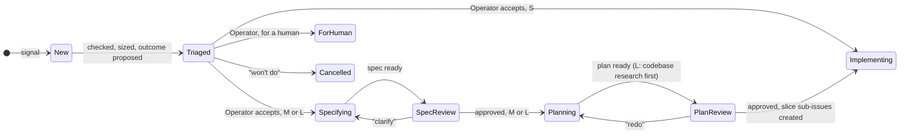
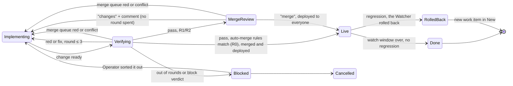

# Work item states and transitions

**Draft, awaiting approval.** The state lives in the tracker (GitHub Issues: a `state:…` label; Jira: a workflow status). The pipeline moves a work item only along the transitions below; a move into a "waits for the Operator" state is a gate. 15 states: 11 on the main line, 4 exits. A state that lasts seconds is not a state: "accepted" and "merged" are transitions.

### Part 1. Preparation: from signal to approved plan

Each slice is a sub-issue of the work item, linked by "blocked by"; a slice is only open or closed. The Orchestrator works the frontier (slices whose blockers are done); the work item stays Implementing until all its slices are merged into its branch.

### Part 2. Execution: from code to production

| State | Stage | Meaning | Who moves it on | Waits for the Operator | GitHub Issues | Jira |
|---|---|---|---|---|---|---|
| New | 1 | Signal recorded, not triaged | Triage agent | no | `state:new` | To Do |
| Triaged | 1 | Checked, size, risk and outcome proposed | Operator | **yes** | `state:triaged` | To Do + label |
| Specifying | 2 | Spec in progress; the Interviewer may ask the Operator business questions | Interviewer | **yes**, while questions are open | `state:specifying` | In Progress |
| SpecReview | 2 | Spec awaiting approval | Operator | **yes** | `state:spec-review` | In Review |
| Planning | 3 | Plan in progress; for L codebase research first | Researcher, Planner | no | `state:planning` | In Progress |
| PlanReview | 3 | Plan awaiting approval | Operator | **yes** | `state:plan-review` | In Review |
| Implementing | 4 | Writing the change, slice by slice | Implementer | no | `state:implementing` | In Progress |
| Verifying | 5 | CI, AI review, then acceptance; for R0 also the merge queue | CI, AI reviewer, Validator | no | `state:verifying` | In Progress |
| MergeReview | 7 | Awaiting merge (R1/R2); merge deploys | Operator | **yes** | `state:merge-review` | In Review |
| Live | 8 | In production, inside the watch window | Watcher | no | `state:live` | Deployed |
| Done | 8 | Done | — | — | closed | Done |
| Blocked | exit | Stuck: 3 fix rounds used up, or a block verdict | Operator | **yes** | `state:blocked` | Blocked |
| RolledBack | exit | Rolled back; the cause goes to a new work item | — | — | closed + `rolled-back` | Done + label |
| ForHuman | exit | A human does it; the pipeline only tracks it | a human | no | `state:for-human` | To Do (human) |
| Cancelled | exit | Cancelled | — | — | closed `not planned` | Won't Do |

The Stage column is the stage number on the overview; stage 6 (Acceptance) shares Verifying with stage 5, stage 9 (Learn) only creates work items in New. The limit "at most 3 work items wait for the Operator" counts items in states where "Waits for the Operator" is yes. The deck's states slide is generated from this table.

## Pull request (PR / MR) states

Draft → checks running → green or red → reviewer verdict (pass / fix / block) → approved by the Operator (R1/R2) → merged or closed. A pull request always links to its work item number.
