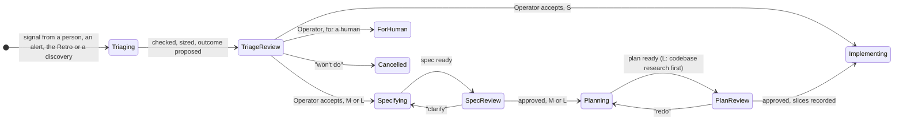

# Work item states and transitions

Approved 2026-11-21 (decision 28), revised 2026-11-24 (decisions 45, 48, 50). The state lives in the engine's store (decision 45); the tracker shows it: a `state:…` label and, where the project's map has one, a workflow status. Any difference between the two is a question to the Operator, never a move. The pipeline moves a work item only along the transitions below; a move into a "waits for a person" state is a gate. 17 states: 13 on the main line, 4 exits. A state says who holds the work item now: an agent or engine state ends in -ing (plus Live), a person's state ends in Review (plus Blocked). A state that lasts seconds is not a state: "accepted" and "merged" are transitions. A request from an author who is not trusted enters Triaging only after the Operator or a trusted author approves its exact text (decision 39). The Operator can cancel a work item in any state; closing it (Cancelled, ForHuman) tells the requester why.

### Part 1. Preparation: from signal to approved plan

Slices and their "blocked by" edges are recorded in the engine and shown as sub-issues where the tracker has them (decision 45); a slice is only open or closed. The Orchestrator works the frontier (slices whose blockers are done); the work item stays Implementing until all its slices are merged into its branch.

### Part 2. Execution: from code to production

```mermaid
stateDiagram-v2
  direction LR
  Implementing --> Verifying: change ready
  Verifying --> Implementing: red, fix, merge queue red or conflict; round ≤ 3
  Verifying --> Blocked: out of rounds or block verdict
  Verifying --> MergeReview: checks pass, R1/R2
  MergeReview --> Implementing: "changes" + comment (no round spent)
  MergeReview --> Verifying: "merge": the merge queue and, where declared, the pre-merge environment
  Verifying --> TestReview: environment green, a person's gate is declared on it
  TestReview --> Implementing: "changes" + comment (no round spent); the hold ends
  TestReview --> Releasing: approved, merged
  Verifying --> Releasing: merged (R0 by the rules, or approved and no person's gate on an environment)
  Releasing --> Live: the release with this item is in production
  Live --> Done: checks over, no regression
  Live --> RolledBack: rolled back, this item is the culprit
  Live --> Releasing: rolled back, another item is the culprit
  Blocked --> Implementing: Operator sorted it out
  Done --> [*]
  RolledBack --> [*]: new work item in Triaging
```

How the same states carry different projects (decision 48):

- **No pre-merge environment** (shape A): Verifying → MergeReview → Verifying (the merge queue) → Releasing → Live. With a release on every merge, Releasing lasts as long as the deploy.
- **A pre-merge environment** (shape B): after the Merge gate the item returns to Verifying for the queue to the environment, the deploy of the candidate (the base branch with the item merged in) and the smoke check (decision 51). Waiting for the environment is a condition inside Verifying: no session runs and no time limit counts. A person's gate on the environment is TestReview (decision 50); the approval is bound to the candidate's git tree (decision 49).
- **R0** changes skip MergeReview and the environment: they merge by the auto-merge rules and wait in Releasing.
- **No environment at all** (a library with nothing to deploy): Releasing → Live → Done pass at once.
- **Releasing** ends when the release that carries the item reaches production. What starts a release is the project's setting: every merge, a schedule, or the Operator. An item marked urgent starts one as soon as it merges (decision 53).
- **A rolled-back release** (decision 52): the culprit goes to RolledBack and is reverted; the other items return to Releasing and ship with the next release.

| State | Stage | Meaning | Who moves it on | Waits for a person | Tracker label | Jira (example map) |
|---|---|---|---|---|---|---|
| Triaging | 1 | Signal received; the Triage agent checks duplicates, reproduces, sizes | Triage agent | no | `state:triaging` | To Do |
| TriageReview | 1 | Size, risk and outcome proposed; the Operator accepts, hands to a human or cancels | Operator | **yes** | `state:triage-review` | To Do |
| Specifying | 2 | Spec in progress; the Interviewer may ask the Operator business questions | Interviewer | no | `state:specifying` | In Progress |
| SpecReview | 2 | Spec awaiting approval | Operator | **yes** | `state:spec-review` | In Review |
| Planning | 3 | Plan in progress; for L codebase research first | Researcher, Planner | no | `state:planning` | In Progress |
| PlanReview | 3 | Plan awaiting approval | Operator | **yes** | `state:plan-review` | In Review |
| Implementing | 4 | Writing the change, slice by slice | Implementer | no | `state:implementing` | In Progress |
| Verifying | 5 | CI, AI review, acceptance; after the Merge gate the merge queue and, where declared, the pre-merge environment (queue, deploy, smoke check) | CI, AI reviewer, Validator, engine | no | `state:verifying` | In Progress |
| MergeReview | 7 | Awaiting the Merge gate (R1 on evidence, R2 reading the code) | Operator | **yes** | `state:merge-review` | In Review |
| TestReview | 7 | Only where a project declares a person's gate on a pre-merge environment: the change runs there and awaits approval | a person on the environment's list | **yes**, outside the cap | `state:test-review` | Testing |
| Releasing | 8 | Merged; waits for the release that carries it, or the release is deploying | engine | no | `state:releasing` | Ready to release |
| Live | 8 | In production, inside its checks (smoke, watch window) | Watcher, engine | no | `state:live` | Deployed |
| Done | 8 | Done | — | — | closed | Done |
| Blocked | exit | Stuck: 3 fix rounds used up, or a block verdict | Operator | **yes** | `state:blocked` | Blocked |
| RolledBack | exit | Rolled back as the culprit; the cause goes to a new work item | — | — | closed + `rolled-back` | Done + label |
| ForHuman | exit | A human does it; the pipeline only tracks it | a human | no | `state:for-human` | To Do (human) |
| Cancelled | exit | Cancelled | — | — | closed `not planned` | Won't Do |

The Stage column is the stage number on the overview; stage 6 (Acceptance) shares Verifying with stage 5, stage 9 (Learn) only creates work items in Triaging. The limit "at most 3 work items wait for the Operator" counts items in TriageReview, SpecReview, PlanReview, MergeReview and Blocked; TestReview and requests about a difference with the tracker are outside it (decisions 45, 50). The Jira column is an example: each project's map says which status, if any, shows a state, and a status the workflow refuses is a difference for the Operator, not a stop. The deck's states slide is generated from this table.

## Pull request (PR / MR) states

Draft → checks running → green or red → reviewer verdict (pass / fix / block) → approved by the Operator (R1/R2) → merged or closed. A pull request always links to its work item number, without a closing keyword ("Part of #n"), so the code host never closes the work item by itself (decision 45).
