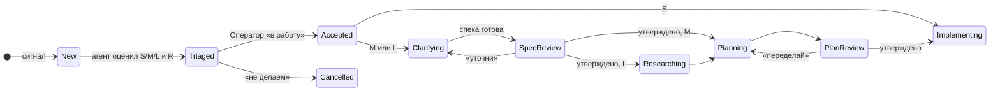
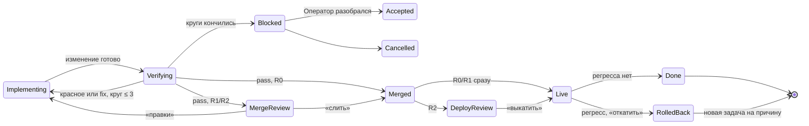

# Состояния задачи и переходы

**Черновик, ждёт утверждения.** Состояние живёт в трекере (GitHub Issues — метка `state:…`, Jira — статус workflow). Конвейер двигает задачу только по переходам ниже; переход в «ждёт Оператора» — это и есть ворота.

### Часть 1. Подготовка: от сигнала до утверждённого плана

### Часть 2. Исполнение: от кода до прода

| Состояние | По-русски | Кто двигает дальше | Ждёт Оператора | GitHub Issues | Jira |
|---|---|---|---|---|---|
| New | Новая | Сортировщик | нет | `state:new` | To Do |
| Triaged | Оценена | Оператор | **да** | `state:triaged` | To Do + метка |
| Accepted | Взята в работу | Оркестратор | нет | `state:accepted` | Selected |
| Clarifying | Уточнение | Интервьюер; ответы Оператора | **да**, если есть вопросы | `state:clarifying` | In Progress |
| SpecReview | Спека на утверждении | Оператор | **да** | `state:spec-review` | In Review |
| Researching | Исследование кода (L) | Исследователь | нет | `state:researching` | In Progress |
| Planning | План | Планировщик | нет | `state:planning` | In Progress |
| PlanReview | План на утверждении | Оператор | **да** | `state:plan-review` | In Review |
| Implementing | Реализация | Исполнитель | нет | `state:implementing` | In Progress |
| Verifying | Проверка и ИИ-ревью | Проверки, ревьюеры, судья | нет | `state:verifying` | In Progress |
| MergeReview | На слиянии (R1/R2) | Оператор | **да** | `state:merge-review` | In Review |
| Merged | Слита | Выкатка | нет | `state:merged` | Done (dev) |
| DeployReview | Выкатка на утверждении (R2) | Оператор | **да** | `state:deploy-review` | Awaiting Deploy |
| Live | В проде, под наблюдением | Дозор | нет | `state:live` | Deployed |
| Done | Готово | — | — | закрыта | Done |
| RolledBack | Откачена | новая задача | — | закрыта + `rolled-back` | Done + метка |
| Blocked | Застряла | Оператор | **да** | `state:blocked` | Blocked |
| Cancelled | Отменена | — | — | закрыта `not planned` | Won't Do |

Лимит «не больше 3 задач ждут Оператора» считает задачи в состояниях, где «Ждёт Оператора — да».

## Состояния изменения (PR / MR)

Черновик → проверки идут → зелёные или красные → вердикт судьи (pass / fix / block) → одобрено Оператором (R1/R2) → слито или закрыто. Изменение всегда ссылается на номер задачи.
