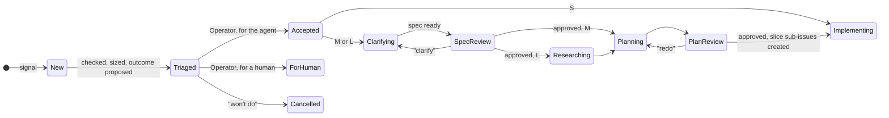
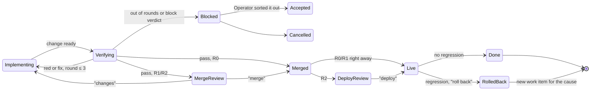

# Work item states and transitions

**Draft, awaiting approval.** The state lives in the tracker (GitHub Issues: a `state:…` label; Jira: a workflow status). The pipeline moves a work item only along the transitions below; a move into a "waits for the Operator" state is a gate.

### Part 1. Preparation: from signal to approved plan

Each slice is a sub-issue of the work item, linked by "blocked by". The Orchestrator works the frontier (slices whose blockers are done); the work item stays Implementing until all its slices are merged into its branch.

### Part 2. Execution: from code to production

| State | Meaning | Who moves it on | Waits for the Operator | GitHub Issues | Jira |
|---|---|---|---|---|---|
| New | Signal recorded, not triaged | Triage agent | no | `state:new` | To Do |
| Triaged | Checked, size, risk and outcome proposed | Operator | **yes** | `state:triaged` | To Do + label |
| ForHuman | A human does it; the pipeline only tracks it | a human | no | `state:for-human` | To Do (human) |
| Accepted | Accepted for work | Orchestrator | no | `state:accepted` | Selected |
| Clarifying | Questions on an underspecified item | Interviewer; Operator answers | **yes**, if there are questions | `state:clarifying` | In Progress |
| SpecReview | Spec awaiting approval | Operator | **yes** | `state:spec-review` | In Review |
| Researching | Codebase research (L) | Researcher | no | `state:researching` | In Progress |
| Planning | Plan in progress | Planner | no | `state:planning` | In Progress |
| PlanReview | Plan awaiting approval | Operator | **yes** | `state:plan-review` | In Review |
| Implementing | Writing the change | Implementer | no | `state:implementing` | In Progress |
| Verifying | CI, AI review, then acceptance | CI, AI reviewer, Validator | no | `state:verifying` | In Progress |
| MergeReview | Awaiting merge (R1/R2) | Operator | **yes** | `state:merge-review` | In Review |
| Merged | Merged | Deploy | no | `state:merged` | Done (dev) |
| DeployReview | Deployment awaiting approval (R2) | Operator | **yes** | `state:deploy-review` | Awaiting Deploy |
| Live | In production, watched | Watcher | no | `state:live` | Deployed |
| Done | Done | — | — | closed | Done |
| RolledBack | Rolled back | a new work item | — | closed + `rolled-back` | Done + label |
| Blocked | Stuck: 3 fix rounds used up, or a block verdict | Operator | **yes** | `state:blocked` | Blocked |
| Cancelled | Cancelled | — | — | closed `not planned` | Won't Do |

The limit "at most 3 work items wait for the Operator" counts items in states where "Waits for the Operator" is yes.

## Pull request (PR / MR) states

Draft → checks running → green or red → reviewer verdict (pass / fix / block) → approved by the Operator (R1/R2) → merged or closed. A pull request always links to its work item number.
